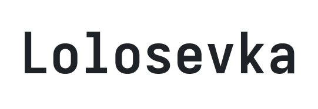
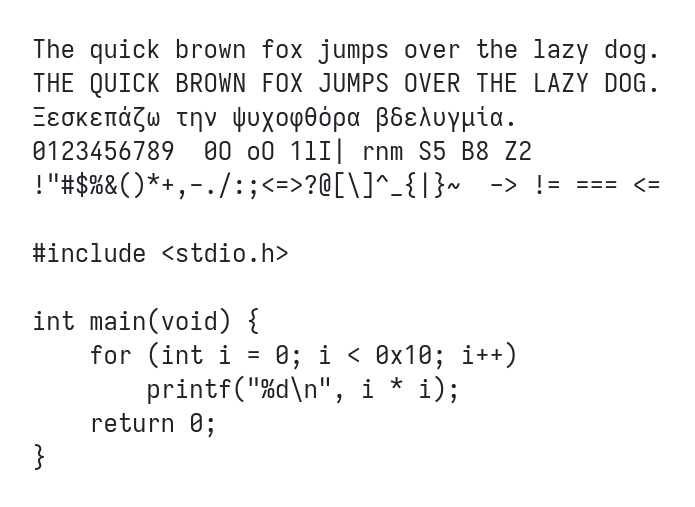
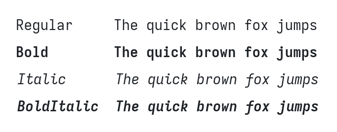

<p align="center"><picture><source media="(prefers-color-scheme: dark)" srcset="images/lolosevka-title.dark.png"></picture></p>

**Lolosevka** is a personal monospace font for code and terminals, built from a fork of
[Iosevka](https://github.com/be5invis/Iosevka) by [Belleve Invis](https://github.com/be5invis).
All the glyph design and the font generator are Iosevka's work; this repo only changes the configuration.

<picture><source media="(prefers-color-scheme: dark)" srcset="images/lolosevka-specimen.dark.png"></picture>

## Differences from Iosevka

- **Wider:** unit width 550 instead of 500, for a slightly airier feel.
- **No ligatures:** `->`, `!=`, `===`, `<=` etc. render as separate characters.
- **Fewer styles:** Regular and Bold, upright and italic, normal width only.
- Everything else (letter shapes, slashed zero, Greek, Cyrillic, symbols) is stock Iosevka.

<picture><source media="(prefers-color-scheme: dark)" srcset="images/lolosevka-styles.dark.png"></picture>

## Build

Requires Node.js and [ttfautohint](https://freetype.org/ttfautohint/).

```sh
npm install
npm run build -- ttf::Lolosevka          # hinted TTFs -> dist/Lolosevka/TTF
npm run build -- ttf-unhinted::Lolosevka # skip hinting, faster
```

Install on Linux:

```sh
mkdir -p ~/.local/share/fonts/lolosevka
cp dist/Lolosevka/TTF/*.ttf ~/.local/share/fonts/lolosevka/
fc-cache -f
```

## Customizing

- `build-plans.toml`: the Lolosevka plan (variants, ligatures, spacing, weights, slopes, widths). See `doc/custom-build.md`, `doc/character-variants.md`, `doc/stylistic-sets.md`.
- `params/*.toml`: global metrics and variant definitions.
- `packages/font-glyphs/src/`: glyph shapes.
- `preview.html`: open in a browser to compare against an installed stock Iosevka.
- `tools/misc/specimen.sh`: regenerate the README images after a build (needs ImageMagick).

## Credits & License

Based on [Iosevka](https://github.com/be5invis/Iosevka), © 2015-2026 Renzhi Li (Belleve Invis) and contributors.
Licensed under the SIL Open Font License 1.1, see `LICENSE.md`.
